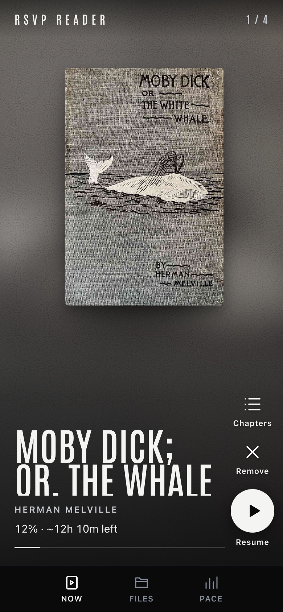
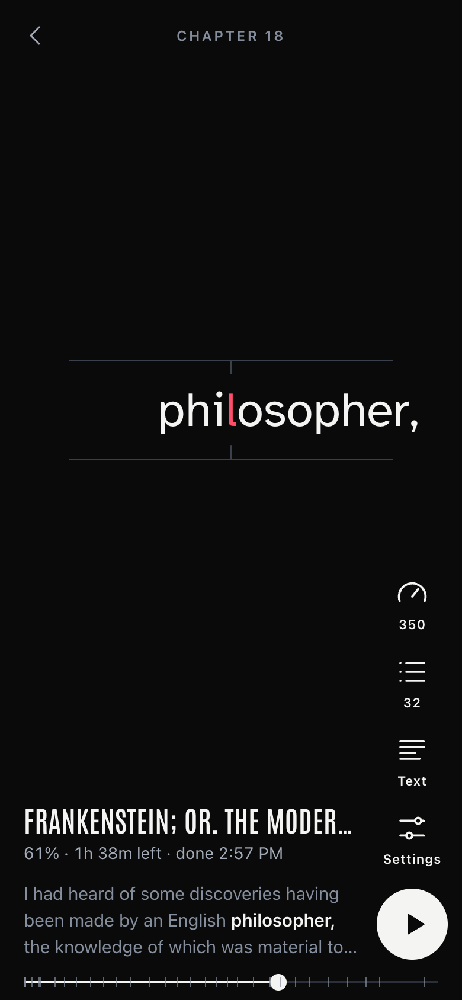
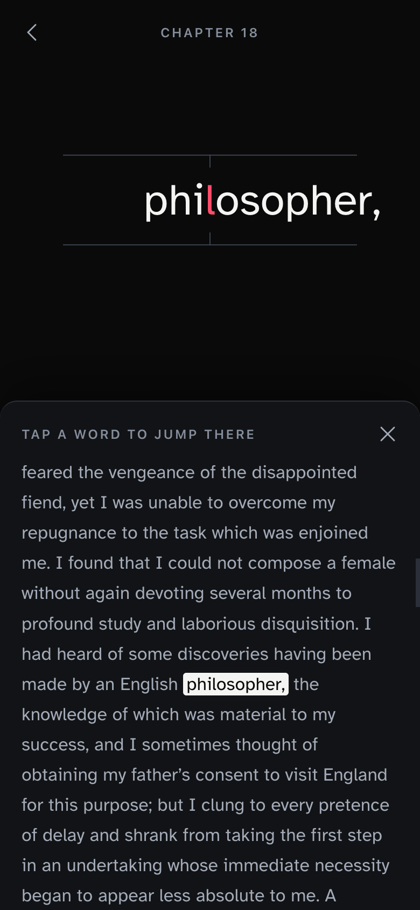
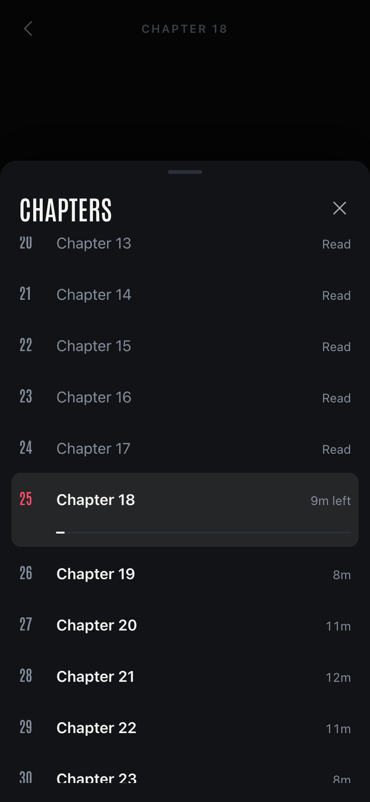
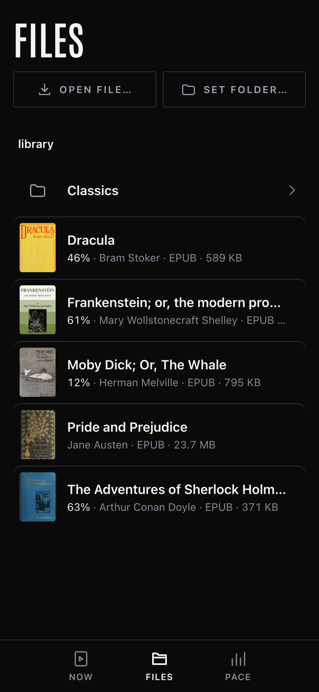
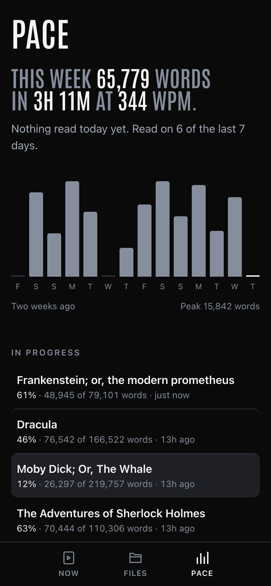
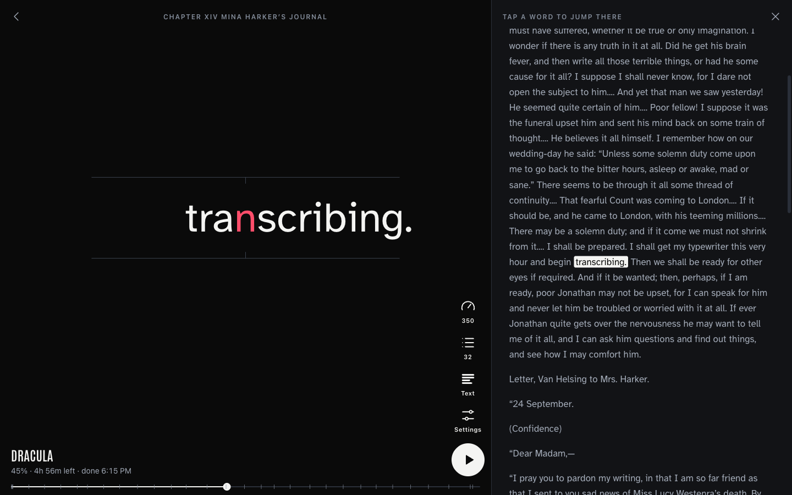

# RSVP Reader

A self-hosted, browser-based speed reader. Opens EPUB, MOBI/AZW, PDF, TXT, and Markdown files and flashes one word at a time using **Rapid Serial Visual Presentation (RSVP)** — the same technique used by apps like Spritz and Spreeder.

Runs as a single Docker container. No accounts, no cloud, no telemetry. Built phone-first for reading in bed; works just as well on a desktop. Access it from any device on your [Tailscale](https://tailscale.com) network.

<p>
  
  
  
  
</p>
<p>
  
  
</p>



<sub>Screenshots use public-domain books from Project Gutenberg.</sub>

---

## Features

- **RSVP playback**: 100 to 800 WPM, with the focus letter (ORP) pinned to a fixed point and fixation guides above and below it. Words too long for the screen shrink to fit rather than getting cut off, and a per-device **word size** setting scales every word down (or up)
- **Smart pacing**: longer pauses at sentence ends, clauses, paragraph breaks, long words and numbers; optional ease-in on resume (backs up a few words and ramps up to speed)
- **Time left, always**: percentage, time remaining at your current speed, and the clock time you'll finish
- **Chapters**: from the EPUB table of contents, PDF outline or Markdown headings, with per-chapter durations, scrubber ticks and `[` / `]` to jump. A jump lands on the chapter heading (not an illustration caption above it), and resuming never rewinds into the previous chapter
- **Pause to re-orient**: pausing shows the current sentence; tap it (or swipe up) for the surrounding text, then tap any word to jump there. On wide screens the text sits beside the word.
- **Now feed**: books in progress, one per screen with their covers; flick to the next
- **Cross-device progress**: saved on your server whenever you pause, jump or leave, and keyed by file content, so renaming or moving a book keeps your place. Coming back to a book you read further on another device picks up there
- **Pace**: words and reading time this week, and the last 14 days. Only words you actually read count; jumping or scrubbing ahead doesn't
- **Phone-first controls**: tap anywhere to play or pause, swipe left or right for sentences, swipe up for the text, thumb-reach controls, screen kept awake while reading (needs HTTPS, see below). Works in landscape too
- **Book metadata**: title, author and cover from EPUB (and MOBI/AZW files that convert to EPUB; older MOBI files show the file name); clean-up for PDFs (de-hyphenation, header/footer and page-number removal)
- **Dark and light themes**: follows your system or a per-device choice
- Supports `.epub`, `.mobi`, `.azw`, `.azw3`, `.pdf`, `.txt`, `.md`

---

## Quick Deploy

### Prerequisites

- A Linux server (home server, VPS, Raspberry Pi, etc.)
- [Docker](https://docs.docker.com/engine/install/) with the Compose plugin
- [Tailscale](https://tailscale.com) installed on the server and your devices (optional but recommended)

### 1. Create the project folder

```bash
mkdir ~/rsvp-reader && cd ~/rsvp-reader
```

### 2. Create `docker-compose.yml`

```yaml
services:
  rsvp:
    image: ghcr.io/joelwilsonmt/rsvp-reader:latest
    ports:
      - "5002:5002"
    volumes:
      - /mnt:/books:ro      # ← change to your books folder
      - ./data:/app/data
    environment:
      - TZ=America/Denver   # ← change to your timezone (also sets the day boundary for stats)
      - BOOKS_DIR=/books
      - DATA_DIR=/app/data
      - FS_ROOT=/books      # the file picker and all book paths are confined to this folder
    restart: unless-stopped
```

Or clone this repo and edit the included `docker-compose.yml`:

```bash
git clone https://github.com/joelwilsonmt/RSVP-reader.git ~/rsvp-reader
cd ~/rsvp-reader
# edit docker-compose.yml: set your books path and timezone
```

### 3. Start the container

```bash
docker compose up -d
```

Docker pulls the pre-built image from GitHub Container Registry — no build step needed.

### 4. Open in a browser

```
http://localhost:5002
```

Or from any device on your Tailscale network:

```
http://<server-tailscale-ip>:5002
http://<server-hostname>:5002   # if MagicDNS is enabled
```

Run `tailscale ip -4` on the server to find its Tailscale IP.

---

## Adding Books

Drop files into the folder you mounted as `/books`. The browse view reads the directory live — no import or scan step needed. Subfolders are supported.

Supported formats: `.epub`, `.mobi`, `.azw`, `.azw3`, `.pdf`, `.txt`, `.md`

You can change the library folder from **Files → Library folder…**, or open a single book from anywhere under `FS_ROOT` with **Files → Open file…** (this does not change your library folder).

---

## Controls

| Key | Action |
|-----|--------|
| `Space` | Play / pause |
| `←` / `→` | Back / forward 10 words |
| `Shift+←` / `Shift+→` | Previous / next sentence |
| `[` / `]` | Previous / next chapter |
| `↑` / `↓` | Faster / slower by 25 WPM |
| `T` | Surrounding text |
| `C` | Chapters |
| `Esc` | Close / back to library |
| `?` | Shortcut list |

On a phone: tap anywhere on the reading area to play or pause, swipe left/right to move by sentence, swipe up for the surrounding text. On the Now feed, swipe up/down between books (`↑`/`↓` or `j`/`k` on a keyboard, `Enter` to resume).

### Keeping the screen awake

Browsers only allow the Screen Wake Lock over HTTPS. If you reach the reader over plain `http://` on your tailnet, the screen may dim while reading. [`tailscale serve`](https://tailscale.com/kb/1312/serve) gives you HTTPS with no certificates to manage:

```bash
tailscale serve --bg 5002
# then open https://<server-hostname>.<tailnet>.ts.net
```

### Security

There are no accounts: anyone who can reach the port can read and change your progress, so keep it on your tailnet or LAN rather than the open internet.

- `FS_ROOT` confines every path the app will open or list (including the library folder and **Open file…**). Set it to your books folder; it defaults to `/`.
- Requests that change anything (progress, settings, library folder) are refused when they come from another site, so a web page you visit can't change them behind your back.

---

## Updating

```bash
docker compose pull
docker compose up -d
```

This pulls the latest image and restarts the container. Your `data/` folder (progress database, text cache) is unaffected. When an update changes how text is extracted, each book is re-extracted once the first time you open it, which can take a few seconds for large books.

---

## Backup

All persistent state lives in `./data/progress.db` (SQLite: progress, daily stats) and `./data/config.json` (library folder, reading settings). `./data/text_cache/` and `./data/covers/` are derived from your books and can be deleted at any time; they are regenerated on next open.

Upgrading from an older version migrates existing progress automatically on first start. If a book can't be found at that point (for example, the books volume wasn't mounted yet), its old progress is kept and picked up on a later start once the file is back.

```bash
# local backup
cp ./data/progress.db ./data/progress.db.bak

# copy off-server
scp yourserver:~/rsvp-reader/data/progress.db .
```

---

## Building Locally

If you want to modify the code:

```bash
git clone https://github.com/joelwilsonmt/RSVP-reader.git
cd RSVP-reader
# edit docker-compose.yml: replace `image:` line with `build: .`
docker compose up --build -d
```

Every push to `main` automatically builds a new image via GitHub Actions and pushes it to `ghcr.io/joelwilsonmt/rsvp-reader:latest` (both `linux/amd64` and `linux/arm64`).

---

## Development

```bash
python3.12 -m venv .venv && . .venv/bin/activate
pip install -r requirements.txt -r requirements-dev.txt
pytest -q
BOOKS_DIR=~/Books DATA_DIR=./data FS_ROOT=$HOME python app.py   # http://localhost:5002
```

## Stack

- **Python 3.12** / **Flask**, served by **gunicorn**
- **ebooklib** + **BeautifulSoup4** for EPUB, **mobi** for MOBI/AZW/AZW3, **pypdf** for PDF
- **SQLite** for progress and stats
- Vanilla HTML, CSS and ES-module JS: no build step, no npm. Fonts (Antonio, Atkinson Hyperlegible, both OFL) are self-hosted, so the app makes no outbound requests.
